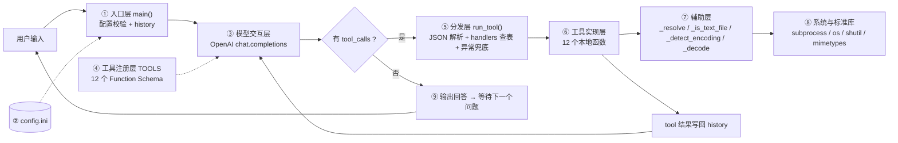
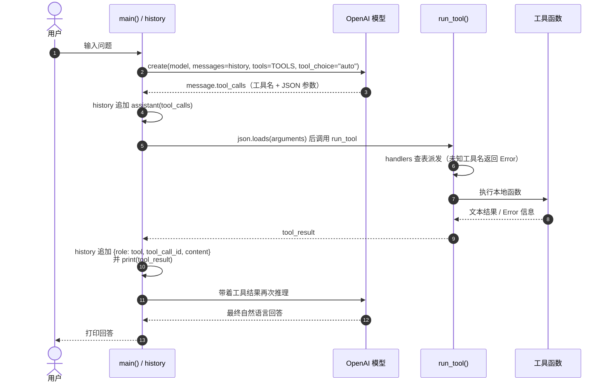

# Practice02 - Function Call 聊天助手

基于 OpenAI SDK 的命令行聊天程序，通过 **Function Call（工具调用）** 让大模型调用本地 Python 函数，
完成日期查询、闰年判断，以及**一整套本地文件系统操作**（列目录、读文件、建目录、删除、重命名等）。

## 版本演进

| 脚本 | 工具数 | 说明 |
| --- | --- | --- |
| `chat.py` | 1 | 基础版本，仅支持 `getDate` |
| `chat_leap.py` | 2 | 新增 `isLeapYear`，工具名用 `if / elif` 硬编码分发 |
| `chat_file.py` | 12 | **最终版本**：工具表驱动（`TOOLS` + `handlers` 字典）+ JSON 参数校验 + 统一异常兜底 + 文件系统增删改查 |

## 文件说明

| 文件 | 说明 |
| --- | --- |
| `chat.py` | 基础版本，支持 `getDate` 工具（获取当前日期时间） |
| `chat_leap.py` | 增强版本，在基础版本上新增 `isLeapYear` 工具（判断闰年） |
| `chat_file.py` | 完整版本，12 个工具，覆盖日期、闰年、路径查询与文件/目录增删改查 |
| `chat_file_architecture.mmd` | `chat_file.py` 代码架构图（Mermaid 纯文本，可用 mermaid.live 或 VS Code 插件渲染） |
| `config.ini` | 配置文件，存放 API 地址、模型名称和密钥（未纳入版本控制） |
| `.gitignore` | 忽略 `config.ini`、`__pycache__/`、`*.pyc` |

## 环境要求

- **Python 3.8 及以上**
- **仅支持 Windows**：`getDate` 通过调用系统 `cmd /c date /t && time /t` 命令获取时间（超时 5 秒），
  其他系统上该工具会返回 `Error`；其余文件类工具跨平台可用
- 依赖：`openai` SDK

## 配置

在脚本同目录创建 `config.ini`（程序按脚本所在目录定位，与启动路径无关）：

```ini
base_url=https://api.deepseek.com
model_name=deepseek-flash
key=你的API密钥
```

- 支持 `#` 开头的注释行与空行
- 缺少 `base_url`、`model_name`、`key` 任一字段时，打印「错误：缺少字段 xxx」并以退出码 1 结束

> 注意：请勿将真实 API 密钥提交到版本库。

## 运行

安装依赖：

```bash
pip install openai
```

运行完整版本（推荐）：

```bash
python chat_file.py
```

运行基础版本 / 闰年版本：

```bash
python chat.py
python chat_leap.py
```

## 架构设计（chat_file.py）

完整架构图见 [`chat_file_architecture.mmd`](./chat_file_architecture.mmd)，可直接用 <https://mermaid.live>
或 VS Code 的 Mermaid 插件渲染。代码分为 8 层：



### 一次工具调用的时序



### 关键设计点

1. **工具表驱动**：`TOOLS` 是 OpenAI Function Schema 列表，`run_tool()` 用 `handlers` 字典按工具名查表派发；
   新增工具只需「加 Schema + 加 handler」，无需改动主循环。
2. **参数防御**：`json.loads` 失败、参数不是 JSON 对象、必填参数缺失，都返回 `Error: ...` 文本给模型，
   模型可据此自我纠正后重试。
3. **异常兜底**：`run_tool()` 用 `try / except` 包住所有工具调用，异常统一转成 `Error: 工具 x 执行失败：...`，
   保证聊天循环不中断。
4. **多轮工具循环**：内层 `while True` 在模型持续请求工具时反复执行「调用 → 回传 → 再推理」，
   直到模型返回纯文本回答（支持一次返回多个 `tool_calls`，逐个执行）。
5. **路径统一化**：所有工具入口先经 `_resolve()`（`expanduser` + `abspath`），相对路径基于进程当前工作目录解析。
6. **编码自适应**：`_is_text_file()` 通过「是否含 NUL 字节 + 能否按 UTF-8/GBK 解码」判定纯文本；
   `_detect_encoding()` 选择读写编码，编辑时保留原文件编码。

## 工具列表（chat_file.py，共 12 个）

| 工具 | 参数 | 功能 |
| --- | --- | --- |
| `getDate` | 无 | 获取当前日期时间（Windows `date /t` + `time /t`） |
| `isLeapYear` | `year` | 判断闰年，返回「N 年是 / 不是闰年」 |
| `getCwd` | 无 | 返回当前工作目录绝对路径 |
| `listDirectory` | `path="."`、`recursive=false` | 列出目录，标注 `[DIR]` / `[FILE] (size bytes)`，最多 500 条 |
| `getFileType` | `path` | 返回 目录 / 文本文件 / 二进制文件、MIME 类型、扩展名 |
| `readFile` | `path`、`max_chars=20000` | 读取纯文本，自动识别 UTF-8/GBK，超长截断 |
| `createFile` | `directory="."`、`filename`、`content` | 创建文件，自动建多级目录，**目标已存在则不覆盖** |
| `editFile` | `path`、`content`、`mode` | `overwrite` 覆盖 / `append` 追加，保留原文件编码 |
| `createDirectory` | `path` | 创建目录（含多级），已存在不报错 |
| `deleteDirectory` | `path` | 递归删除目录及全部内容，带安全护栏 |
| `deleteFile` | `path` | 删除单个文件 |
| `renamePath` | `src`、`dst` | 重命名/移动，目标不可已存在，父目录不存在时自动创建 |

### 常用工具细节

**getDate**（仅 Windows）

```python
subprocess.run(["cmd", "/c", "date /t && time /t"], capture_output=True, timeout=5)
```

输出编码随终端代码页变化，`_decode()` 依次尝试 UTF-8 → GBK，仍失败则用 `errors="replace"` 兜底。

**isLeapYear**（纯 Python）

```python
def isLeapYear(year):
    if (year % 4 == 0 and year % 100 != 0) or (year % 400 == 0):
        return True
    return False
```

闰年规则：能被 4 整除且不能被 100 整除；或能被 400 整除。

**readFile**：非纯文本文件直接返回 `Error: ... 不是纯文本文件`；
`max_chars` 非法或 ≤ 0 时回退到默认值 20000，截断时追加「...（内容已截断，文件共 N 字符）」。

## 常量与限制

| 常量 | 默认值 | 作用 |
| --- | --- | --- |
| `SCRIPT_DIR` / `CONFIG_PATH` | 脚本所在目录 / `config.ini` | 与启动目录无关地定位配置 |
| `MAX_LIST_ENTRIES` | `500` | 单次列目录最多返回条目数，超出显示「条目过多」提示 |
| `DEFAULT_MAX_CHARS` | `20000` | 读取文件默认最大字符数 |
| subprocess 超时 | `5` 秒 | `getDate` 命令超时保护 |

## 安全护栏

- `deleteDirectory` 拒绝删除：磁盘根目录、当前工作目录本身、当前工作目录的上级目录
- `createFile` 目标已存在时**不覆盖**，需改用 `editFile`
- `readFile` / `editFile` 只处理纯文本文件，二进制文件直接报错
- `renamePath` 目标路径已存在时报错，不会静默覆盖
- 所有工具错误均以 `Error:` 文本返回，不抛异常、不中断对话

## 使用示例

```
你好，有什么问题（支持 function call: getDate, isLeapYear, getCwd, listDirectory, ...）

我：现在几点？顺便看看当前目录里有什么
---
2026-02-13 10:21:33
目录：D:\xx\agent\practice02
[FILE] .gitignore (29 bytes)
[FILE] README.md (2449 bytes)
[FILE] chat.py (3644 bytes)
...
现在是 2026-02-13 10:21:33。当前目录下有 chat.py、chat_leap.py、chat_file.py 等脚本及配置文件。
```

```
我：把刚才的目录概览保存到 notes/overview.md
---
已创建文件：D:\xx\agent\practice02\notes\overview.md（512 bytes）
已把目录概览写入 notes/overview.md（目录不存在时程序会自动创建）。
```

> 每次工具返回的原始结果都会先打印（便于调试），随后是模型据此生成的最终回答。

## 工作流程

1. 用户输入问题，程序把 `history` 连同 `TOOLS` 一并发送给大模型
2. 大模型判断需要调用工具时返回 `tool_calls`（工具名 + JSON 参数）
3. 程序把 assistant 消息（含 `tool_calls`）写入 `history`，解析参数后交给 `run_tool()` 派发执行
4. 执行结果以 `{role: "tool", tool_call_id, content}` 回传，模型据此继续推理
5. 若模型继续请求工具，重复步骤 2-4，直到模型不再请求工具为止
6. 输出最终回答，回到步骤 1 等待下一个问题

## 扩展新工具

1. 编写实现函数，返回值统一为**字符串**，出错时返回 `Error: ...`
2. 在 `TOOLS` 中追加一条 Function Schema（`name` / `description` / `parameters`）
3. 在 `run_tool()` 的 `handlers` 字典中追加对应分支（可同时做参数缺失检查）
4. 如需读写文件，复用 `_resolve()`、`_is_text_file()`、`_detect_encoding()` 以保持一致行为
